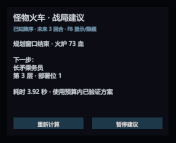

# Live battle advisor

Windows player 0.2.7 defaults to `WholeBattle = true`: search targets battle
victory/defeat/stalemate, rather than stopping after three EndTurns. Winning
routes are compared by final Pyre health; finding the first winning seed no
longer ends the search. The panel shows forecast Pyre loss and explicitly labels
partial forecasts when the budget cannot reach battle end. These bounded
heuristic results do not certify global optimality or unknown future randomness.

The player defaults to `SearchWorkers = 2`, capped at two lower-priority search
threads and at logical processors minus one (minimum one). Their independent
deployment/policy searches split the same 256-node allowance and share a 3,000ms
wall-clock budget; an atomic model expansion can overrun that soft deadline.
Full-state keys and RNG caches are private to each worker. Native capture stays
on Unity's thread, while verification remains on the coordinator worker.
`SearchWorkers = 1` selects serial search; `WholeBattle = false` restores the
configured `Horizon` window. The existing installed hotkey is preserved.

`MaxSteps = 256` bounds each route, including card plays, abilities and EndTurns,
so looping/endless states cannot create unbounded paths. It is configurable
from1 to4096; reaching the cap never masquerades as a terminal result. The
existing twelve-actions-per-turn, node and time limits also remain in effect.

Launch the interactive copied game with:

```powershell
pwsh -NoProfile -File scripts/Run-BattleAdvisor.ps1
```

For an isolated whole-battle parallel session, add `-WholeBattle -SearchWorkers 2`
and optionally `-MaxSteps 256`. These modes use the in-process model; the
separate .NET planner keeps its existing fixed-window protocol.

Play normally. The development launch defaults to a fixed window. Its panel shows the next card/ability, floor, deployment slot
or target, and the forecast Pyre HP after up to three EndTurns. The complete-plan
button expands a scrollable sequence grouped by turn; collapsing restores the
next-step summary. Viewing the plan does not capture or search. Future actions
are forecasts from the current state and update after actual inputs. F8 hides/shows
the development overlay (the installed player's existing key is preserved);
its buttons refresh or pause recommendations. `-Horizon 2` selects
two EndTurns. The overlay does not play cards automatically.

Longer known-state continuations are opt-in: `-TacticalSeed -Horizon 12
-TimeLimitMs 30000` enables the bounded tactical seed described in
[offline planning](offline-planning.md). Use `-OuterBoss` to project the
calibrated unpaired original outer-boss deployment/phase state. This enables
the same birth/turn capture flags used in its native acceptance; other outer-boss
definitions still retain their explicit model guards. The defaults stay at
three turns/3,000 ms, and long forecasts can take considerably longer to publish.
Add `-DotNetPlanner` to run search and independent model verification in an
isolated .NET 8 process. Native capture, UI publication, invalidation and player
controls stay in the game. Binary requests/results are retained in its profile;
see [the process boundary and timings](offline-planning.md).

The command prints its isolated `Profile`. Pass that same directory with
`-Profile .probe-runs/advisor-<timestamp>-<suffix>` to resume that progress.
Omitting `-Profile` creates a new copy of `.probe-baseline`. `-NativeWorker 2`
uses the second game copy, and `-SkipBuild` reuses built assemblies. The
installed game's plugins, original saves and preferences are not deployment
targets. The interactive launcher clears inherited probe/calibration variables,
enables snapshot metadata and physical spawn references, and respects the
profile's native game speed and audio settings.



The image is the actual native Unity UI for seed 424243, rendered to a dedicated
texture and cropped to the panel. Occluded/locked Windows sessions returned
black desktop screenshots; this image is not a full-game desktop screenshot.
The capture has 328 text vertices and 83,011 non-background pixels before
cropping. The Canvas uses a GraphicRaycaster and a blocking panel image.

## Execution and freshness

`BattleAdviceSession` accepts only immutable model snapshots. One background
coordinator runs the bounded planner, optionally with one search helper, and independently replays every selected step
before publishing a complete continuation. Unity/game APIs stay on the main
thread; detached snapshot keys and floor-equivalence comparisons are also
prepared on a background worker. The UI polls completed preparations without
waiting. Input/selection/busy revisions and a cheap observation check reject
outdated preparations before a complete root match can reach the panel.
Node/time budgets, complete no-card fallback and completed fixed-policy
seeds retain the planner's existing semantics.

Card plays, EndTurn, undo and restart invalidate advice. Floor selection retains
the worker and verifies a rebased continuation. Native input/settlement and
tracked card/unit mutations schedule captures; an allocation-free observation
of turn, phase, floor, resources and pile counts detects additional changes.
Settled advice skips complete capture, full-state hashing and the full animation
scan while those inputs remain unchanged. Full-state keys still retain unit
and card identities, histories, selected floor and gameplay RNG. New requests
cancel obsolete work and retain only the latest pending snapshot. Generation
checks reject results even if an old worker finishes after cancellation.
Cancellation waits for an atomic expansion to finish on the worker; the UI
thread never waits for that worker. Undo/restart and new manual battles reset
the capture identities. Scene changes recreate a cleared panel without ending
the static advice service. A failed/incomplete calculation hides its advice;
the user can continue playing and refresh or resume the panel.

Each live capture compares native resources, piles, units/statuses and rooms,
every native RNG stream including presentation streams, Unity RNG state and
frame before/after projection. This checks the captured state boundary, not
every private engine field. Comparison failures hide advice and remain failures
in the evidence. A result is advisory, uses known captured deck order/RNG and
does not establish global optimality or hidden-draw probabilities.

## Natural encounter evidence

The [full-battle rolling report](rolling-advisor.md) extends the earlier window
tests below: a new recommendation supplies every executed first step until
actual battle end. It includes three distinct actual bosses (rings one, two and
five), an additional seventh-ring mechanic control, completed native policy
comparisons and capture-to-publication timings. Later encounters use controlled
native map navigation with the starter deck; the middle/later losses do not
establish campaign wins.

Six archives form three live-source/fresh-native-replay pairs. All six full
battles are settled native wins, with CaptureFailures, Mismatches, Unsupported
and Pending equal to zero. The replay processes search zero nodes and reproduce
every frozen step, full intermediate state, planning-window state and RNG.
Each live source publishes an initial recommendation, invalidates it after
the first action and publishes a newly computed recommendation. The test
driver then continues the original frozen sequence for independent replay.
The overlay's refreshed result is also independently model-replayed.

These are three naturally generated first-ring battles from seeds 424242,
424243 and 424244, covering Junker and Horde encounters. `InTestScenario` is
false, modifier setup is empty, and no scenario-authored card plays are present.
Every battle naturally spawns `Boss_Level1_Basic`, marked native `IsMiniboss`.
They are not three distinct campaign bosses and do not validate later-ring
or outer-train boss encounters. Native speed is Instant for acceptance runs;
the interactive launcher preserves the user's own speed.

| Seed | Encounter | Window / no-card Pyre HP | Steps | Search ms | Completed fixed-policy seed |
| --- | --- | --- | ---: | ---: | --- |
| 424242 | Level1BattleJunker | 80 / 74 | 10 | 3130.8 | Incomplete; comparison unknown |
| 424243 | Level1BattleHorde | 73 / 73 | 12 | 3922.9 | Same score, -72931.5 |
| 424244 | Level1BattleHorde | 80 / 73 | 12 | 3642.8 | Same score, -79949 |

All roots are turn two with a three-EndTurn horizon. The Pyre values describe
the planning window, not terminal battle HP. Seed 424243 improves only the
positional score over its no-card baseline. Search uses a three-second soft
budget; an atomic expansion can overrun it. These measurements exclude main
thread capture and the worker's independent plan verification, so they are not
end-to-end response deadlines. Incomplete fixed-policy seeds are not reported
as beaten. Retained continuations are never worse than a completed seed.

| Seed | Source suffix (20261021) | Fresh replay suffix | Pure captures | Publications | Invalidations | Frames while planning |
| --- | --- | --- | ---: | ---: | ---: | ---: |
| 424242 | 083959-e3bd5377 | 084117-36bf3696 | 41 | 2 | 27 | 1238 |
| 424243 | 084209-8cac8d3b | 084323-2580fe5c | 45 | 2 | 26 | 2216 |
| 424244 | 083921-ad59cd38 | 084313-c20dc45d | 44 | 2 | 28 | 1698 |

All source purity-failure counters are zero. Runs use the
`.probe-runs/full-battle-units-spells-and-junk-` prefix. Retained binaries are
`full-battle-advisor-<seed>-search.mt2f` and `-replay.mt2f`; sizes, hashes and
node counts are in `manifest.tsv`. Sources span UI revisions: the 424243
source additionally records the explicit offscreen render counters. The pure
advice-session tests separately cover rejected late results, latest-snapshot
coalescing, one worker, budget fallback, failure and nonblocking disposal.

Run only the focused checks, or create a fresh native pair:

```powershell
pwsh -NoProfile -File scripts/Check-BattleAdvisor.ps1
pwsh -NoProfile -File scripts/Run-PlannerBenchmark.ps1 -Case starter -Advisor -Seed 424243
```

The separate native benchmark driver automates inputs; the interactive launcher
does not. The interactive entry was also smoke-tested through native startup,
save-root redirection and a live game window without the autoplay driver.

Outer-train boss support, later-ring wins with progressed decks, unknown-draw
planning, broader campaign combinations and global optimality remain outside
the combined evidence.
